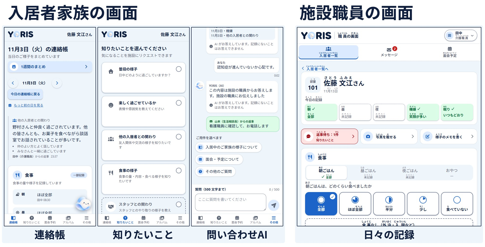
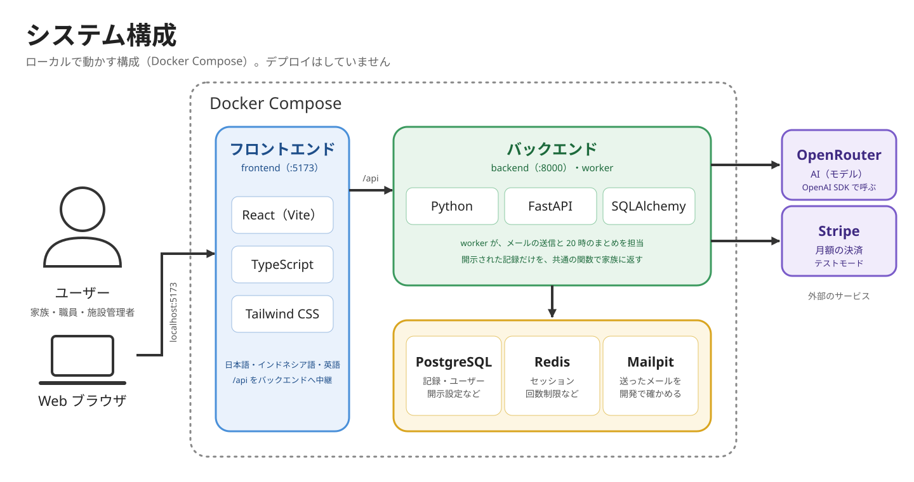

<p align="center">
  
</p>

# YORIS（ヨリス）

介護施設と入居者家族のための連絡アプリ。連絡帳と「知りたいこと」リクエストで、家族が入居者の様子を施設職員に遠慮することなく知ることができます。

> 「寄り添う」＋ Assist（支援）。 Ms.Engineerプログラミングブートキャンプの最終課題として、チーム4人 × 4週間で、企画から開発を行いました。



※ 画面の人物・データは、すべて架空です。

## 資料

- [スライドとデモ動画（Canva）](https://www.canva.com/design/DAHavYgylUw/wHI0QiElbKcgrYNGDTAlUg/view)
- [PRD（企画・要件）](./docs/PRD.md)

## 解決したいこと

- 家族が介護施設に入居者している人は、**入居者の日々の様子が分からず不安**に思っていても、忙しそうな施設に電話するのは**気が引ける**。
- 職員は、お世話の最中に家族からの電話で**業務が中断**される。外国人職員は、日本語で記録を書く負担も大きい。
- 既存のサービスは、家族の連絡を職員が全部読んで返す形が多く、双方向にすると**職員の負担が増える**。

YORIS は、**入居者家族が施設に遠慮せずに知れること**と、**職員の負担を増やさないこと**の両立を目指します。

## 主な機能

| 機能 | 中身 |
| --- | --- |
| 連絡帳 | 日々の様子（食事・機嫌・眠り）を家族が確認する。 |
| 知りたいこと | 家族がテーマのボタンでリクエストを送り、職員が定型文＋αで返事。返事は連絡帳のいちばん上に届く。 |
| 記録 | 職員が食事量・機嫌・眠りを、ボタンだけで記録する。 |
| 開示設定 | 家族に何を見せるかを、施設が選ぶ。 |
| 問い合わせ AI | 家族の質問に、開示された記録だけをもとにAIが答える。医療・苦情・お金など、人の対応が要るものは質問のカテゴリ情報を付けて職員に渡す。AIは医療判断をしない。 |
| 面会予約 | 家族が空き時間を見て面会を予約する。 |
| アルバム | 職員が撮った写真を、その入居者の家族だけが見る。 |
| 外国人職員の記録の支援 | 母語で書いた様子のメモを、AIが日本語に整え、確認と承認を経て連絡帳に載せる。 |
| 変化の検知 | 食事量が続けて少ないなど、「いつもと違う様子」に職員が気づける。 |
| 多言語・ふりがな | 日本語・インドネシア語・英語の切り替え。漢字にふりがなをつける。 |
| 通知 | アプリ内のお知らせとメール通知。 |
| 申し込みと利用料の支払い | 施設が申し込み、月額利用料をStripeで支払う。支払い後にログインIDが発行され、入居者や職員のアカウントを登録して使い始める。 |

機能ごとの詳しい仕様は、[specs/](./specs/) にあります。

## 構成



- AI のエージェントは、フレームワークを使わず、ループを自分で書いています（上限回数つき）。
- 家族に見せる記録は、必ず共通の関数を通し、**開示された分だけ**を返します。AI も同じ関数を通します。

## 使った技術

- フロントエンド：React（Vite）、TypeScript、React Router、Tailwind CSS、react-i18next、TanStack Query、Vitest、Playwright
- バックエンド：Python 3.13、FastAPI、SQLAlchemy、Pydantic、Alembic、pytest
- データ：PostgreSQL、Redis
- AI：OpenRouter（OpenAI Python SDK のツール呼び出し）
- 決済：Stripe Billing（サンドボックス）
- 開発環境：Docker / Docker Compose

選んだ理由は、[技術選定](./docs/技術選定.md) にまとめています。

## 動かし方

ローカルで動かすところまでで、デプロイはしていません。Docker が必要です。

```bash
git clone https://github.com/fumi217/yoris.git
cd yoris
cp env.example .env          # AI を使うときだけ、OPENROUTER_API_KEY などを入れる
docker compose up -d
docker compose exec backend alembic upgrade head
docker compose exec backend python -m app.seed   # 架空の初期データ
```

- アプリ：http://localhost:5173
- API の一覧：http://localhost:8000/docs
- メール（Mailpit）：http://localhost:8025
- ログインは、開発用のユーザー切り替え（画面の右下）で入ります。詳しくは [backend/README.md](./backend/README.md) と [frontend/README.md](./frontend/README.md) を見てください。
- データは、すべて**架空**です。

**保存しても自動で読み直されないとき（Windows 側のフォルダで動かしているときなど）**：
リポジトリの一番上の `.env` に `WATCH_POLLING=true` を書いて、`docker compose up -d` で起動し直す。
フロント（Vite）とバックエンド（uvicorn）が、変更を定期的に見に行くようになる（少し重くなるので、困ったときだけ使う）。

## ドキュメント

- [PRD](./docs/PRD.md)：企画・要件の全体像
- [技術選定](./docs/技術選定.md)：使った技術と、選んだ理由
- [画面設計](./docs/画面設計.md)
- [デザインの決めごと](./docs/デザインの決めごと.md)
- [テスト設計書](./docs/テスト設計書.md)
- [マイルストーン](./docs/マイルストーン.md)
- [specs/](./specs/)：機能ごとの仕様（spec・plan・data-model・contracts・tasks）。DB や API の設計は、ここにあります