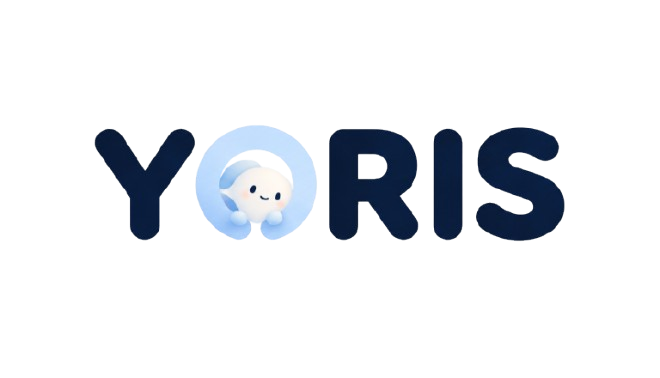
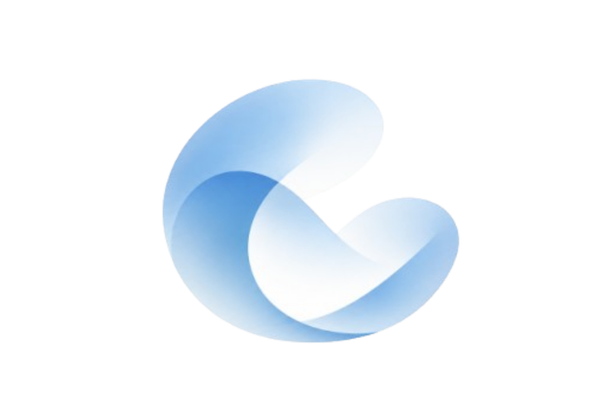
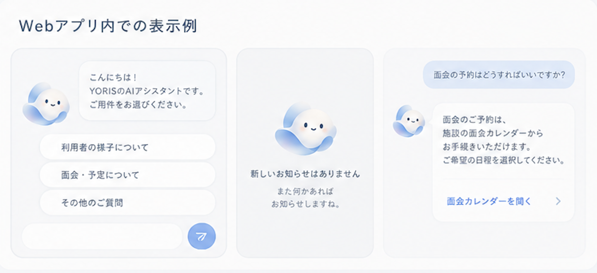

# デザインの決めごと

画面のトーン＆マナー（雰囲気・色づかい・余白・部品の形）と、アクセシビリティの決めごと。#285。
アクセシビリティは、**WCAG 2.2 の AA を目標に設計し、10 のチェック表と「確かめた記録」で確かめる**（「AA 準拠」とは言い切らず、何を確かめたかを示す。PR #286 ようこさん）。

- **この版は案**。チームで話し合って決める（PR のレビューで全員が確認する）。決まったら、Tailwind のテーマと共通の部品に入れる Issue と、画面ごとに当てる Issue を分けて立てる
- 大きなデザインシステムは作らない。色・文字・押せる大きさ・共通の部品（5 つまで）だけを決める（10/28 のデイリースクラムのようこさんの案）
- 見た目の参考は、#285 に貼った 2 枚のデザインの画像（ゆうさんのトンマナの案・みさきさんの職員の画面の追加案）。**画像と同じ色にはしない**。雰囲気はそろえ、色の濃さは AA を満たすところまで変える
- 画像にあって仕様にないもの（入居者の新規登録・検索・バイタル・年齢・性別・職員が面会の予約を足す・時間を変える・予約者の連絡先を出す など）は作らない。取り入れるなら、先に spec で話す（#285 の「話し合うときに気をつけること」）
- constitution の UI 方針（絵文字とアイコンの併用・やさしい日本語・ふりがな）と、[画面設計](./画面設計.md) に合わせる
- **アプリの名前は YORIS（ヨリス）に決まった**（10/29）。ロゴとキャラクターの使い方は **12 章**、AI の一次対応の画面（お問い合わせ）の刷新の案は **13 章**

## 1. 使う人と場所・雰囲気

| 画面 | 使う人 | 主な端末 | 大事にすること |
|---|---|---|---|
| 家族の画面（`/family`） | 入居者の家族（50 代の会社員が昼休みに読む想定） | スマホ（縦。幅 360px 前後） | 短い時間で読める。ふりがなは出さない（constitution 3.2.0） |
| 職員の画面（`/staff`） | 介護職員・リーダー（外国人の職員を含む）・生活相談員・施設長 | タブレット | 押しやすい・押し間違えない。ふりがなを出す。画面を遮る表示を使わない（原則 II の趣旨に合わせた、この文書の決めごと） |
| 管理画面（`/admin`） | 事務員・生活相談員・施設長 | PC（タブレットでも使える） | 一覧で見渡せる。ふりがなを出す |

**雰囲気（言葉 3 つ）**：やさしい・あたたかい・見やすい。医療・監視の印象（真っ白・冷たい灰色・赤の多用）は避ける。

**取り入れるトンマナ**（ゆうさんの案）
- 薄い青みの背景に、白いカード（角丸・薄い影）を並べる
- 主の色は青（主なボタン・選ばれたタブ・選ばれたメニュー）
- 状態は、色の付いた小さなラベル（未対応・対応済み・来訪予定など）と件数のバッジで見せる。**色だけに頼らず、ラベルの文字でも分かる**ようにする（1.4.1）
- 見出しは大きめ、行間はゆとりを持たせる
- 人物のアイコン（顔の形の丸いアイコン）は使わない。名前は文字だけで出す。そのほかのアイコン・絵文字（メニュー・食事・機嫌・眠り・お知らせなど）は使う（constitution の UI 方針）
  - **YORIS のキャラクターは、人物ではないので、この決まりの対象外**（12 章）。ただし、家族・職員の名前の横には置かない（人物のアイコンの代わりにしない）。AI の発言のそばに置くときは、AI であることを文字でも示す（13 章）

## 2. 色

コントラスト比は、WCAG の計算式で測った値。**文字は 4.5:1 以上**（大きな文字＝24px 以上、または太字で約 18.7px 以上は 3:1 以上。1.4.3）、**入力欄・ボタンの枠・アイコン・フォーカスの枠など、文字以外で意味のあるものは 3:1 以上**（1.4.11）。押せない状態（`disabled`）の部品は、基準の対象外。

### 2.1 画像の色を測った結果

画像の色を拾って測ると、次のところが AA に足りない。

| 画像の色の組み合わせ | コントラスト比 | 基準 | 判定 |
|---|---|---|---|
| 主の青 `#1878d8` の上の白い文字（主なボタン） | 4.45 | 4.5 | **足りない** |
| 灰色の小さい文字 `#a8aeba`（白の上。日時・補足） | 2.23 | 4.5 | **足りない** |
| 赤いバッジ `#fc5454` の上の白い文字（件数） | 3.21 | 4.5 | **足りない** |
| 薄い緑のラベル `#c0f0d8` の上の緑の文字 `#54ae96`（来訪予定・記録済み） | 2.12 | 4.5 | **足りない** |
| 選ばれたメニュー `#d8e8f8` の上の青い文字 `#1878d8` | 3.57 | 4.5 | **足りない** |
| 濃い紺の文字 `#06123c`（白の上。本文・見出し） | 18.11 | 4.5 | OK |

### 2.2 色の案（トンマナはそのまま、濃さだけ AA に合わせる）

| 名前（Tailwind のテーマの名前の案） | 色 | 使うところ | コントラスト比 |
|---|---|---|---|
| `page`（画面の背景） | `#eef5fb` | 画面の背景（薄い青） | — |
| `card`（カード） | `#ffffff` | カード・入力欄の中 | — |
| `card-line`（カードの枠） | `#d6dee8` | カードの区切り（飾りの線。意味は持たせない） | 白 1.36、`page` 1.23（飾りなので基準の対象外） |
| `ink`（本文） | `#0f1f3d` | 本文・見出し | 白 16.36 |
| `ink-sub`（補足の文字） | `#5b6474` | 日時・補足・説明 | 白 5.97、`page` 5.42 |
| `primary`（主の青） | `#1d64c8` | 主なボタンの背景・リンク・選ばれたタブ・フォーカスの枠 | 白の文字 5.66、`page` の上の文字 5.15、`primary-soft` の上の文字 4.64 |
| `primary-soft`（薄い青） | `#dbeafe` | 選ばれたメニュー・選ばれた行の背景（**色だけで「選ばれた」を伝えない**。`page` との比は 1.11 でほぼ見分けられないので、太字と左の線を必ず添える。5 章） | `ink-sub` の文字 4.89 |
| `field-line`（入力欄・選ぶボタンの枠） | `#748097` | 入力欄・チェックの枠・選ぶボタンの枠 | 白 3.98、`page` 3.62、`primary-soft` 3.26（1.4.11。どの背景の上でも 3:1 以上。PR #286 ようこさん。前の案の `#8a94a6` は `page` の上で 2.78 だった） |
| `danger`（危ない・件数のバッジ） | `#c81e1e` | 件数のバッジ・取り消しなど危ない操作 | 白の文字 5.74 |
| ラベル：成功 | 文字 `#166534`・背景 `#dcfce7` | 対応済み・来訪予定・記録済み | 6.49 |
| ラベル：注意 | 文字 `#92400e`・背景 `#fef3c7` | 未対応・締め切り間近 | 6.37 |
| ラベル：警告 | 文字 `#991b1b`・背景 `#fee2e2` | エラー・未返信・急変は電話の案内 | 6.80 |

- 主の青は、今のアプリの `sky-700`（`#0369a1`。白の文字 5.93）から、画像に近い少し明るい青（`#1d64c8`）に変える案。`sky-700` のままでも AA は満たす
- 赤は「危ない・急ぎ」にだけ使い、多用しない（医療の印象を避ける）

### 2.3 今のアプリで直すところ

| 今の書き方 | コントラスト比 | 直し方 |
|---|---|---|
| 入力欄・選ぶボタン・チェックの枠 `border-gray-300`（`#d1d5db`） | 1.47 | **3:1 に足りない**（1.4.11）。`field-line`（`#748097`）にする |
| 文字 `text-gray-400`（`#9ca3af`） | 2.54 | 4.5 に足りない。`ink-sub` にする（押せない部品の中の文字は対象外） |
| 文字 `text-gray-300`（`#d1d5db`。面会のカレンダーの期間外の日など） | 1.47 | 期間外の日は、押せないことを数字の薄さだけで伝えている。`ink-sub` にして、押せる日は枠で区別する |
| 文字 `text-gray-500` を `bg-gray-100` の上に置く | 4.39 | 4.5 に少し足りない。`ink-sub` にする |

`text-gray-600`（7.56）・`text-sky-700`・`text-red-700`（6.47）・`text-orange-700` を `bg-orange-50` の上（4.88）は、今のままで AA を満たす。

**直し方（10/29。#346・PR #347）**：10/30 のアプリレビューの前に全画面へ効かせるため、今の画面のクラス名は書き換えず、`frontend/src/index.css` で**値だけを差し替えた**。そのため、**クラス名と中身の色がずれている**ので、読むときに気をつける。
- `sky-700` は YORIS の主の青（`primary`。`#1d64c8`）、`sky-600`・`sky-800` も同じ青の薄い・濃い色
- `gray-300` は `field-line`（`#748097`）、`gray-400`・`gray-500` は `ink-sub`（`#5b6474`）。Tailwind の元の灰色ではない
- 新しく書く画面は、意味のある名前（`bg-primary`・`text-ink-sub`・`border-field-line` など）を使う。今のクラス名を意味のある名前に書き換えるのは、レビューのあとに少しずつ行う
- 色を指定していない線（`border`・`divide-y`）は、Tailwind の初期値の文字の色（`ink`）のまま。薄くすると、色を指定していない入力欄の枠まで 3:1 に足りなくなるため（PR #347 ようこさん）

## 3. 文字

| 画面 | 本文 | 見出し（画面の題） | 補足 | 行間 |
|---|---|---|---|---|
| 家族 | 18px（`text-lg`） | 24px（`text-2xl`）・太字 | 16px（`text-base`） | 1.7 |
| 職員・管理 | 16px（`text-base`） | 20〜24px・太字 | 14px（`text-sm`。12px 以下は使わない） | 1.7。ふりがなの `<ruby>` が付く行だけ 2.0（ふりがなが上に付くため。#196。行間を全体で広げると職員の画面が間延びするので、ふりがなの行に限る。PR #286 みさきさん） |

- 太さは、普通（400）と太字（700）の 2 つだけ
- 文字の大きさは px ではなく rem で指定する（Tailwind の `text-*`）。ブラウザの文字の拡大で、そのまま大きくなるように（1.4.4）
- 行間・文字の間隔を利用者が広げても、文字が欠けたり重なったりしないように、高さを固定しない（1.4.12）

## 4. 押せる大きさ

- AA の基準：**24×24px 以上**（2.5.8）
- 目標：職員のタブレットと家族のスマホで押す部品は **44×44px 以上**（`min-h-11 min-w-11`。AAA の 2.5.5 と同じ大きさ）。今の記録のボタン（`min-h-14`）・返事のボタン（`min-h-12`）は満たしている
- 押せる部品どうしは、8px 以上あける（押し間違いを減らす）

## 5. 色だけに頼らない（1.4.1）

- 状態は、色に加えて文字（ラベル）やアイコンでも示す（例：「未対応」の文字、記録済みの ✔）
- 選ばれたメニュー・タブ・行は、背景の色（`primary-soft`）だけにせず、**太字と左の線（`primary`。`primary-soft` との比 4.64）**を添える。選ぶボタンは、今の「見せる／見せない」のように、選ばれた方の文字を太字にするか、✔ を添える（PR #286 ようこさん）
- 面会のカレンダーの日の状態（予約あり・空きあり・満員・休止日）は、色の点だけにせず、文字（「空きなし」など）か形を添える（みさきさんの 05 の案）
- リンクは、色に加えて下線を付ける

## 6. キーボードとフォーカス・読み上げ

- キーボードだけで、すべての操作ができる（2.1.1）。フォーカスの順番は、画面の見た目の順と同じにする（2.4.3）
- フォーカスの枠をはっきり見せる（2.4.7）：`primary` の 2px の枠を、部品から 2px 離して付ける（`focus-visible:outline-2 focus-visible:outline-offset-2`）。消さない
- フォーカスした部品が、固定の上の枠や、家族の画面の下に固定したメニューの後ろに隠れない（2.4.11）。下に余白（今の `pb-20`）を残し、スクロールで見える位置に来るようにする
- 画面ごとに、何の画面かが分かるタイトル（`<title>`）を付ける（2.4.2）
- 見出し（`h1`・`h2`）とラベルで、中身が分かるようにする（2.4.6）
- アイコンだけのボタンには、読み上げの名前（`aria-label`）を付ける。飾りの絵文字・アイコンは読み上げない（`aria-hidden`）（1.1.1・4.1.2）
- 「保存しました」などの知らせは `role="status"`、エラーは `role="alert"` で、読み上げにも伝える（4.1.3。今の画面の形をそろえる）
- ページの言語（3.1.1）：今は `index.html` が `lang="ja"` で固定。表示言語を切り替えたら、`<html lang>` も `ja`・`id`・`en` に変える（PR #286 ようこさん）
- 言語が変わる所に `lang` を付ける（3.1.2）：インドネシア語・英語の表示、様子のメモの原文（今の画面で付けている形をそろえる）
- ふりがなの `<ruby>` が、読み上げ（iPhone の VoiceOver・Android の TalkBack）でどう読まれるか（漢字と読みが二重に読まれないか）を、職員の画面で実機で確かめる（PR #286 ようこさん）

## 7. 共通の部品（5 つまで）

| 部品 | 決めごと |
|---|---|
| ボタン | 主（`primary` の背景・白の文字）／副（白の背景・`field-line` の枠・`ink` の文字）／危ない操作（`danger`。取り消しは 2 回押す確認 `ConfirmButton`）。押せない状態は薄くし、押せない理由を近くに文字で出す |
| 入力欄 | 上にラベル（3.3.2）、枠は `field-line`、文字数の上限があるときは数を出す。エラーは入力欄の近くに、何が違って、どう直せばよいかを文字で出す（3.3.1・3.3.3） |
| エラー表示 | `role="alert"`。警告のラベルの色（文字 `#991b1b`・背景 `#fee2e2`）に、⚠️ などのアイコンを添える。画面を遮らない |
| カード | 白の背景・角丸（8px）・`card-line` の枠か薄い影。中の文字は `ink`・`ink-sub` |
| 見出し | 画面の題は `h1` を 1 つ。区切りは `h2`。題の横に日付や件数を添えるときは、補足の大きさ |

- 職員向けの画面では、画面を遮る表示（ダイアログ・トースト・音）を使わない。知らせは画面の中に出す（原則 II（職員の入力負担を増やさない・家族の問い合わせが職員に割り込む経路を作らない）の趣旨に合わせた、この文書の決めごと。PR #286 さとこさん）
- ツールチップ（ホバーで出る説明）は、なるべく使わない。使うなら、Esc で消せる・上にマウスを乗せても消えない・自分で消すまで消えない、にする（1.4.13）

## 8. 画面の枠（話し合うこと）

- **職員・管理画面**：今は上の枠（題・ほかの画面へのリンク・名前・ログアウト）。画像の案は、**左のメニュー**（アイコン付き）＋パンくず。
  - 左のメニューにするなら、タブレットの縦や狭い幅では、メニューをたたむ（幅 320px で横にスクロールしない。1.4.10）
  - 職員の画面と管理画面で、メニューの並びと名前をそろえる（3.2.3・3.2.4）
- **家族の画面**：下のメニュー（4 つ＋「☰ その他」）は変えない（spec 001 の Clarifications）
- **管理画面のトップ**：みさきさんの案（04）の、アイコン・名前・ひとことの説明が付いたカードのタイル
- **全画面の左上に YORIS のロゴ（文字つき。`logo-wordmark.png`）**（ゆうさんの案。12.3。以下、この項目の「ロゴ」はロゴ（文字つき）のこと）。今の上の枠の左には、家族の画面は**入居者の呼び名**、職員・管理画面は**題（職員の画面・管理画面）**があるので、次のように並べる案（話し合うこと）
  - 家族：左にロゴ、右に入居者の呼び名（幅 360px で収まる大きさ。12.3）
  - 職員・管理：左にロゴ、その右に題。ロゴと題は**同じ行き先のリンクなので、1 つのリンクにまとめる**（2.4.4。隣り合う同じ行き先のリンクを分けない）
  - 上の枠の左に置くので、左のメニューにするか（上の話し合い）に関わらず、ロゴの場所は変わらない
- **家族のホーム（連絡帳）の右下にキャラクター**（ゆうさんの案。12.4）。下に固定したメニューの上に置き、メニューに重ねない

## 9. 確かめ方

- 色を決めるときは、コントラスト比を計算して、この表に書く（WebAIM の Contrast Checker など、計算の道具を使う）
- 画面を作ったら、10 のチェック表で確かめる。ブラウザの拡大（200%）と、幅 320px の表示も見る
- 自動の確かめ（例：E2E（Playwright）に axe-core を足して、各画面の AA の違反がないかを見る）は、入れるならチームに共有して、技術選定に理由を書く

## 10. WCAG 2.2 AA のチェック表

画面ごとに、次を確かめる（A の基準も、AA の前提として入れる）。

| 分け方 | 基準 | 確かめること |
|---|---|---|
| 見た目 | 1.3.1（A） | 見出し・一覧・表の構造が、読み上げに伝わる（`h1`・`ul`・`table` など、見た目だけで作らない） |
| 見た目 | 1.3.4（AA） | 縦・横どちらの向きでも使える（職員のタブレット。向きを固定しない） |
| 見た目 | 1.3.5（AA） | 入力欄の目的が分かる（ログイン・申し込みの `autoComplete`。今の画面で付けている形をそろえる） |
| 見た目 | 1.4.3（AA） | 文字のコントラスト比 4.5:1 以上（大きな文字は 3:1） |
| 見た目 | 1.4.11（AA） | 入力欄・ボタンの枠・アイコン・フォーカスの枠が 3:1 以上 |
| 見た目 | 1.4.1（A） | 色だけで意味を伝えていない |
| 見た目 | 1.4.4（AA） | 200% に拡大しても、読めて使える |
| 見た目 | 1.4.10（AA） | 幅 320px で、横にスクロールせずに読める |
| 見た目 | 1.4.12（AA） | 行間・文字の間隔を広げても、欠けたり重なったりしない（ふりがなの行） |
| 見た目 | 1.4.13（AA） | ホバー・フォーカスで出る内容が、消せる・上に乗れる・すぐ消えない（使うなら） |
| 見た目 | 1.4.5（AA） | 文字を画像にしない。ただし**ロゴ（YORIS）は例外**。ロゴには読み上げの名前（`alt="YORIS"`）がある（12.3） |
| 動き | 2.2.2（A） | 自動で始まり 5 秒を超えて動くもの（キャラクターのふわふわ）が、5 秒以内に止まる、または止められる。OS の「動きを減らす」設定のときは動かさない（12.4） |
| 動き | 2.3.1（A） | 1 秒に 3 回より多く点滅しない（点滅は使わない） |
| 操作 | 2.1.1（A） | キーボードだけで使える |
| 操作 | 2.4.3（A） | フォーカスの順番が、見た目の順と同じ |
| 操作 | 2.4.7（AA） | フォーカスの枠が見える |
| 操作 | 2.4.11（AA） | フォーカスした部品が、固定の枠・メニュー・**右下のキャラクター**に隠れない |
| 操作 | 2.5.8（AA） | 押せる部品が 24×24px 以上（目標は 44×44px） |
| 操作 | 2.4.4（A） | リンクの目的が、文字（と前後の文）で分かる（例：「この家族のメッセージを見る」。11.2） |
| 操作 | 2.5.3（A） | ボタンの見える文字と、読み上げの名前が合う（`aria-label` を付けるときも、見える文字を含める） |
| 操作 | 2.5.7（AA） | ドラッグでしかできない操作がない（今は使っていないので該当なし。並べ替えなどを足すときは、ボタンでもできるようにする） |
| 操作 | 2.2.1（A） | 時間の制限を延ばせる・なくせる（2 回押す確認 `ConfirmButton` は時間の制限をなくした。自動ログアウト（#66）は下の「話し合うこと」） |
| 分かりやすさ | 1.1.1（A） | アイコンだけのボタンに名前がある。飾りは読み上げない。ロゴ（文字つき）は `alt="YORIS"`、キャラクターの絵は飾り（`alt=""`）で、押せるキャラクターはリンクの名前がある（12.3・12.4） |
| 分かりやすさ | 2.4.2（A） | 画面ごとのタイトルがある |
| 分かりやすさ | 3.1.1（A） | ページの言語（`<html lang>`）が、表示言語と合っている |
| 分かりやすさ | 3.2.6（A） | ヘルプ（「緊急のときは、施設から電話します」・「お急ぎのときは、施設にお電話ください」など）が、画面ごとに同じ場所・同じ順で出る |
| 分かりやすさ | 2.4.6（AA） | 見出しとラベルで中身が分かる |
| 分かりやすさ | 3.1.2（AA） | 言語が変わる所に `lang` がある |
| 分かりやすさ | 3.2.3・3.2.4（AA） | メニューの並びと、同じ働きの部品の名前がそろっている |
| 入力とエラー | 3.3.1（A）・3.3.2（A） | エラーの場所が分かる。入力欄にラベルがある |
| 入力とエラー | 3.3.3（AA） | エラーのときに、直し方を示す（#79 のエラーの文言） |
| 入力とエラー | 3.3.4（AA） | お金に関わる操作（申し込み・お支払いの変更・解約）で、誤りを防ぐ（送る前に確かめられる・取り消せる） |
| 入力とエラー | 3.3.7（A） | 同じことを何度も入力させない（申し込みのステップで、前に入れた内容を引き継ぐ） |
| 入力とエラー | 3.3.8（AA） | ログイン・申し込みで、パスワードの貼り付けやパスワード管理の道具を妨げない |
| 読み上げ | 4.1.2（A） | 部品の名前と状態（押されている・開いている）が読み上げに伝わる |
| 読み上げ | 4.1.3（AA） | 「保存しました」などが読み上げにも伝わる（`role="status"`） |

**決めたこと（10/28。2 対 1）**：2 回押す確認（`ConfirmButton`）は、**5 秒で元に戻すのをやめ、「やめる」を押すか 2 回目を押すまで残す**（時間の制限（2.2.1。A）をなくす）。素早い 2 回のタップを受け付けない 0.5 秒の決まりは残す（押し間違いを防ぐため）。
- みさきさん・ようこさん：「やめる」を押すまで残す案が、手間も少なく確実（賛成）
- さとこさん：画面の中の確認ボタンが 1 回目の状態に戻るだけなので、時間の制限としては軽い
- 実際に使ったときの声（PR #283 の手動確認。ようこさん）：面会の「休みにする」「取り消す」で、理由を入れてから確かめの文を読むと、5 秒で 1 回目に戻ってしまうことがあった

**話し合うこと**：自動ログアウト（#66）も、時間の制限（2.2.1）に当たる。ようこさんの案は、切れる前に警告を出し、20 秒以上の余裕で延長できるようにする形（#66 の実装の前に決める）。

### 確かめた記録

画面を作ったら、画面ごとに次の表に書く（発表で「AA を目標に設計し、何を確かめたか」を示すため。PR #286 ようこさん）。自動の確かめ（axe-core）を入れたら、その結果も書く。

| 画面 | キーボードだけで使える | 200% に拡大 | 幅 320px | コントラスト（測った値） | 読み上げ（ふりがな・状態） | 確かめた日・人 |
|---|---|---|---|---|---|---|
| （例）UI-A02 面会の設定 | | | | | | |

## 11. 画面ごとの案（メッセージ・面会予約）

みさきさんの職員の画面の追加案（03・05・06。#285 の画像）の見せ方を取り入れる案。**機能は今の仕様のまま**にし、見せ方だけを変える（仕様にない機能は入れない）。決まったら、[画面設計](./画面設計.md) の UI-S08・UI-S09・UI-S11 を先に直し、画面ごとに Issue を立てる。

**画面を直す Issue は、10/30 のアプリレビューのあとに取りかかる**（新しい画面（予約の詳細）と画面設計の変更を含み、レビューまでの時間が少ないため。PR #286 ようこさん）。吹き出し・カレンダーの背景など、ここで新しく使う色は、作るときに値を決めて 2.2 の表に足し、コントラスト比を測る。

### 11.1 家族からのメッセージ（UI-S08 一覧・UI-S09 詳細。みさきさんの案 03）

**入れるもの**
- 一覧のタブ：「すべて」「対応待ち」「対応済み」の 3 つ（今は 2 つ。言葉は spec 004 の「対応待ち・対応済み」のまま）。件数は「（2 件）」のように文字でも出す
- 一覧の行：「佐藤さんの母のご家族」（入居者の呼び名から作る）・質問の要約の 1 行・受け付けた日時・状態のラベル（対応待ち・対応済み）。行を押すと、そのやり取り（詳細）へ進む（今と同じ）
- 詳細：やり取りを、時刻の順に吹き出しで並べる（家族・AI・職員）。返事は、今と同じ定型文のボタン（1 つ以上）と書き足し（100 文字まで）。「自分が対応する」も今のまま

**入れないもの**：入力欄 1000 文字・添付（spec 004 の返事の形のまま）。人物のアイコン（1 章）

**WCAG 2.2 AA のための作り**
- タブ：`role="tablist"`・`role="tab"`・`aria-selected`。`role="tab"` にするなら、左右の矢印キーでタブを切り替えられるようにする（難しければ、タブの見た目のリンクにして、`aria-current` で今のタブを示す。PR #286 ようこさん）。選ばれたタブは、色に加えて太字と下の線で示す（1.4.1）。件数は文字で読み上げにも伝わる（1.3.1）
- 一覧の行：行全体を 1 つのリンクにする（押せる高さ 44px 以上。2.5.8）。状態は、色のラベルに加えて「対応待ち」「対応済み」の文字で示す（1.4.1）。日時は `ink-sub`（4.5:1 以上。1.4.3）。要約が長いときに 1 行で切っても、詳細では全文が読める
- 吹き出し：だれの発言かを、位置（左右）や色だけで示さず、吹き出しの上に「ご家族」「AI」「職員（名前・職種）」の文字を出す（1.3.1・1.4.1）。やり取りは順番のある一覧（`ol`）にする（1.3.1）。吹き出しの背景と文字は 4.5:1 以上
- 定型文のボタン：選んだかを `aria-pressed` で伝え、色に加えて ✔ と太字で示す（1.4.1・4.1.2）。押せる大きさ 44px 以上
- 書き足しの欄：上にラベル（3.3.2）。文字数（「0 / 100」）は欄と `aria-describedby` でつなぐ。エラーは `role="alert"` で、直し方を文字で出す（3.3.1・3.3.3）
- 「一覧へ戻る」：開いた側（職員の画面・管理画面）の一覧へ戻る（今と同じ。3.2.3）

### 11.2 面会予約（職員の画面・管理画面。UI-S11 を置き換える。みさきさんの案 05・06）

**入れるもの**
- 月のカレンダー：日ごとの状態（予約あり・空きあり・満員・休止日）を出す。前の月・次の月・「今日」のボタン
- 日を選ぶと、その日の予約（時刻・家族・状態）をカレンダーの横（狭い幅では下）に出す。予約を押すと、予約の詳細へ進む
- 予約の詳細（新しい画面）
  - 予約の情報：日時・入居者（呼び名・居室）・人数・状態・予約した日時
  - ご家族：「佐藤さんの母のご家族」（入居者の呼び名から作る。家族の一人ひとりの名前は持っていない）
  - 「この家族のメッセージを見る」ボタン：家族からのメッセージの一覧を、その入居者で絞って開く（`?resident_id=`。#88 の仕組み。苦情は生活相談員・施設長にだけ出る決まりは、API がそのまま守る）
  - 変更履歴：予約した・家族が取り消した・施設が取り消した（取り消した職員・理由）を、時刻の順に（今あるデータで出せる。spec 003 の FR-012）
  - 取り消し：今と同じ、理由（必須・200 文字まで）を入れて 2 回押す
- 今日の面会予定（UI-S12）は、そのまま残す

**入れないもの**：職員の「予約を追加」・「時間を変更」・家族の電話・メール・メモ（spec 003 にない。電話・メモは持っていないデータ、メールは見せる範囲の相談が要るため）

**WCAG 2.2 AA のための作り**
- カレンダー：曜日の見出し（`th`）がある表にする（1.3.1）。日はボタン（押せる大きさ 44px 以上。2.5.8）。日の状態は、色の点だけにせず、「2 件」「満」「休」などの文字を添え、読み上げの名前にも入れる（例：「10月16日（金）予約 2 件」。1.4.1・4.1.2）。凡例も文字で出す。選んだ日は `aria-pressed` と、色に加えて太字・枠で示す（1.4.1）。今日は「今日」の文字を添える
- 月の移動：「前の月」「次の月」「今日」は文字のボタン（2.5.3）。月が変わったら、月の名前を `aria-live="polite"` で伝える（4.1.3）
- 狭い幅（320px）では、カレンダーの下にその日の予約を並べ、横にスクロールさせない（1.4.10）
- 予約の詳細：画面の題は `h1`、区切り（予約の情報・ご家族・変更履歴・取り消し）は `h2`（1.3.1・2.4.6）。予約の情報は、見出しと値の組（`dl`）。変更履歴は時刻の順の一覧（`ol`）
- パンくず（「ホーム ＞ 面会予定 ＞ 予約の詳細」）は `nav`（`aria-label="パンくず"`）にし、今の画面に `aria-current="page"`（2.4.8 は AAA だが、3.2.3 のメニューの並びをそろえる助けになる）
- 状態のラベル（予約済み・家族が取り消し・施設が取り消し）は、色に加えて文字で示す（1.4.1）
- 取り消し：理由の欄にラベル（3.3.2）、エラーは直し方を文字で（3.3.3）、2 回押す確認（2.2.1 は 10 章の「話し合うこと」）
- 「この家族のメッセージを見る」は、行き先が分かる文字のリンク（2.4.4）

### 11.3 確かめること（作ったら）
- 10 章のチェック表と「確かめた記録」に、UI-S08・UI-S09・面会のカレンダー・予約の詳細の行を足して書く
- キーボードだけで、タブの切り替え・一覧から詳細・カレンダーの日の選択・取り消しまでできるか
- 幅 320px と 200% の拡大で、カレンダーとやり取りの吹き出しが崩れないか

## 12. YORIS の名前・ロゴ・キャラクター（10/29。ゆうさんの案）

**アプリの名前は YORIS（ヨリス）**に決まった（「寄り添う」＋ Assist（支援）。10/28 のスプリントの記録の候補 1）。ロゴとキャラクターが決まったので、画面に組み込む前に、使い方をここに決める。
**決まったこと**と**案（話し合うこと）**を分けて書く。画像は `docs/images/yoris/`（元データ。画面を作る Issue で `frontend` に置く）。

### 12.1 素材（4 点・すべて背景が透明な PNG）

この文書で**ただ「ロゴ」と書いたら、ロゴ（文字つき）**（`logo-wordmark.png`。口頭の「テキストロゴ」「名前ロゴ」）のこと。文字のない絵は「**マーク**」（ロゴ（マークだけ）。`logo-mark.png`）と書く。

| 素材 | 呼び方 | ファイル | 全体の大きさ | 余白を除いた大きさ（縦横比） | 使うところ |
|---|---|---|---|---|---|
| ロゴ（文字つき） | ロゴ・テキストロゴ・名前ロゴ | [`logo-wordmark.png`](./images/yoris/logo-wordmark.png) | 660×378 | 471×118（4.0 : 1） | 全画面の左上（12.3） |
| ロゴ（マークだけ） | マーク | [`logo-mark.png`](./images/yoris/logo-mark.png) | 612×408 | 302×269（1.12 : 1） | 文字が入らない小さな所（案：ブラウザのタブの絵・ホーム画面に追加したときの絵） |
| キャラクター（ふつうの顔） | キャラクター（ふつう） | [`mascot-normal.png`](./images/yoris/mascot-normal.png) | 612×408 | 287×256（1.12 : 1） | 家族のホームの右下（12.4）・AI の発言の横（13 章）・お知らせが空のとき |
| キャラクター（嬉しい顔） | キャラクター（嬉しい） | [`mascot-happy.png`](./images/yoris/mascot-happy.png) | 612×408 | 306×254（1.20 : 1） | キャラクターを押したときの切り替え（12.4） |

「余白を除いた大きさ」は、**半透明のふちも含めて**測った（ふちが切れないように。透明でない画素が 1 つでもある範囲）。

   

- 余白がとても大きい。**ロゴ（文字つき）は、見える部分（半透明のふちを含む）が、画像全体（660×378）の約 14%**（完全に不透明な部分だけなら 12%。余白を除いた四角でも 22%）。画面の中でロゴが占める割合ではなく、画像ファイルの中の割合。キャラクターも、幅の半分ほど。画面に置くときは、**余白を切り取った画像**を使う（元は変えない）。上の「余白を除いた大きさ」が目安で、**切り取るときは、さらに外側に 2px の余白を足す**（ふちの薄い部分が切れないように）
- **キャラクターの 2 枚は、同じ大きさのキャンバス（612×408）で、体の位置がほぼそろっている**（余白の端は、左 151・153、上 58・51、下 94・103 で、数 px〜9px のちがい。右の羽の形が少し違い、右の余白は 174・153）。切り替えで絵が跳ねないよう、**2 枚をまとめた共通の枠で、同じ位置を切り取る**：**左 151・上 51・幅 308・高さ 263**（縦横比 1.17 : 1。半透明のふちも含めて測った。12.4）
- 解像度は、切り取った幅の半分までなら、2 倍の画面（スマートフォン）でもぼやけない：ロゴ（文字つき）は表示の幅 約 235px まで、キャラクターは共通の枠（幅 308px）で **約 150px まで**（12.4 は幅 64〜72px）。それより大きく出すときは、SVG か大きな画像を作り直してもらう
- **出どころ**：ゆうさんが **ChatGPT（Pro プラン）で生成した**（ロゴ・キャラクター・13 章の参考画像。10/29 に提出）。**マークは、Canva で書き出した**（ゆうさんが Canva を使っている。画像の埋め込み情報より）。作り直すときに同じ雰囲気にそろえられるよう、生成した日と指示文（プロンプト）は、分かれば記録しておく。**使ってよい条件**（生成物・書き出した素材の扱い）は、OpenAI と Canva の利用規約で、課題の提出・発表の範囲で使えることを、まだ確かめていない（12.5 の「まだ決まっていないこと」）
- **画像の埋め込み情報**：書き出したツールは、作成ツール・チーム名・作者名・日付などを、画像の中（EXIF・XMP）に入れることがある。**人の名前が入ることがあるので、消してから置く**。マークは、この情報（EXIF・XMP）を消してある（絵は変えていない）。書き出し直したときも、同じように消す（`exiftool -all=` など）。参考画像には、大きさ・向きの情報と、色の情報（ICC）だけが残っていて、人名・作者の情報はない

### 12.2 色（画像から測った結果）

画像の色を 16 段階にまとめて数え、WCAG の計算式でコントラスト比を出した（おおよその値）。`page` は 2.2 の `#eef5fb`。

| 画像の色 | 色（目安） | 白との比 | `page` との比 | 不透明な部分のうちの割合 |
|---|---|---|---|---|
| ロゴ（文字つき）の文字 Y・R・I・S | `#081838` | 17.53 | 15.93 | 約 6 割（近い濃紺を合わせて約 65%） |
| ロゴ（文字つき）の O の輪 | `#c8e8f8` | 1.28 | 1.17 | 約 8% |
| ロゴ（マークだけ）の濃いほうの青 | `#88b8e8` | 2.09 | 1.90 | 約 6% |
| ロゴ（マークだけ）の薄い青 | `#d8e8f8` | 1.25 | 1.14 | 約 10% |
| キャラクターの体 | `#f8f8f8` | 1.06 | 1.04 | 約 24〜34%（嬉しい顔は、薄いクリーム色 `#f8f8e8` も約 9%） |
| キャラクターの羽の青（濃いところ） | `#88b8f8` | 2.05 | 1.86 | 約 4〜5%（ふつうの顔） |

分かったこと：
- **ロゴ（文字つき）の文字の濃紺（`#081838`）は、本文の `ink`（`#0f1f3d`。白との比 16.36）とほぼ同じ濃さ**で、AA を満たす。ロゴ（文字つき）の文字は、本文と同じ色の系統として扱ってよい
- ロゴ（文字つき）・マークの青と、キャラクターの青は、やわらかい薄い青（白との比 1.25〜2.09）。**文字・ボタン・枠には使わない**（操作の色は `primary`（`#1d64c8`）のまま）。ロゴ・飾りの絵は、1.4.3・1.4.11 の対象外（ロゴは例外・飾りは意味を持たない）なので、薄くてよい
- **キャラクターの体は、白や `page` の背景とほぼ同じ明るさ（1.04〜1.06）**。縁の青と影で形が分かる。背景に溶けないよう、**薄い影（`drop-shadow`）を付ける**（12.4）。実際に画面に置いたら、目で見て確かめる
- ロゴ（文字つき）の O の輪は薄い（`page` との比 1.17）。**背景は白か `page` にし、濃い色や写真の上には置かない**（O の形が読めなくなる）

### 12.3 ロゴ（文字つき）（全画面の左上）

**決まったこと**：全画面の左上に、YORIS のロゴ（文字つき）を置く。この節の「ロゴ」は、ロゴ（文字つき）のこと（12.1）。マークではない。

**案（話し合うこと）**
- **置く画面**：家族（`/family` の下すべて）・職員（`/staff`）・管理画面（`/admin`）の上の枠と、ログイン・申し込みの画面
- **今の上の枠との並べ方**（8 章）：家族は左にロゴ・右に入居者の呼び名、職員・管理画面は左にロゴ・その右に題（ロゴと題は 1 つのリンクにして、押すとそのまとまりのトップへ）
- **大きさ**：高さ **28px（家族）〜 32px（職員・管理）**（幅は縦横比 4 : 1 から、約 112〜128px）。**最小は高さ 24px**。幅 320px でも横にスクロールしない（1.4.10）
- **まわり**：ロゴの高さの半分以上の余白をあける。色を変えない・縦横比を変えない・回さない・影や縁を付けない
- **読み上げ**：``（ロゴは名前の代わりの文字。1.1.1）。ロゴがリンクのときは、行き先は上の枠のまわり（現在のまとまり）から分かる
- **画面のタイトル**：`<title>` を「画面の題 ｜ YORIS」にする。今の `index.html` の「家族連絡アプリ」を YORIS に変える（2.4.2）
- **ファビコン**：今の `favicon.svg` を、ロゴ（マークだけ）から作った絵に差し替える（案）

### 12.4 キャラクター（家族のホームの右下）

**決まったこと**（ゆうさんの案）
- 家族の使うホームの**右下**に、キャラクターを置く
- **少し上下にふわふわ**動かす
- **押したら、嬉しい顔の絵に切り替えてから、画面を移る**

**案（話し合うこと）**

**どこに置くか**
- 置く画面：キャラクターは**家族の画面だけ**（職員・管理画面には出さない）。**右下に固定して置くのは、家族のホーム（連絡帳。UI-F02 `/family`）だけ**。ほかの家族の画面では、固定せず、AI の発言の横（13 章）と、お知らせが空のときに置く
- 位置：画面の右下（右から 16px）。**下に固定したメニューの上**（メニューの高さ ＋ 16px）に置き、メニューに重ねない
  - **メニューの高さは、決まった値にせず、画面で測る**（PR #340 で決めた）。幅が狭い・文字を大きくしたときは、メニューの名前が折り返して高くなる（360px で 49px・320px で 65px）。家族の画面の枠（`FamilyLayout`）が `ResizeObserver` で測って、CSS の変数 `--family-menu-height` に入れる
  - 列（`max-w-xl`）の中の右下に置く。幅の広い画面でも、画面の右端ではなく、列の右端から 16px
- 大きさ：幅 64〜72px。押せる大きさは 44×44px 以上（2.5.8）。**外側の枠は固定して、中の絵だけを動かす**（動くあいだに、押す場所がずれないように）

**動き（ふわふわ）**
- 絵を上下に ±6px、2.4 秒で 1 往復。動かすのは `transform: translateY` だけ（周りのレイアウトがずれない）
- **自動で始まって 5 秒を超えて動くものは、止められなければならない（2.2.2。A）**。次の 2 案がある

| 案 | 中身 | 良いところ | 気になるところ |
|---|---|---|---|
| **A（おすすめ）** | 画面を開いたとき、2.4 秒の往復を **2 回（4.8 秒）だけ**動かして、止まる | 5 秒以内なので、止める仕組みが要らない。画面も設定も増えない | ずっと動き続けるわけではない |
| B | 動き続ける。「☰ その他」の「設定」に「キャラクターの動き（入／切）」を足す | ずっとふわふわしている | 設定の項目・保存先が増える（仕様の追加。spec 001 の設定の画面） |

- **決まった（10/29）：案 A**（ようこさんの考え。ゆうさんが採用）。設定の項目は増やさない
- どちらの案でも、**OS の「視差効果を減らす」設定（`prefers-reduced-motion: reduce`）のときは、動かさない**

**押したとき**
1. 押した瞬間に、嬉しい顔の絵に切り替える（絵は、画面を開いたときに読み込んでおく。押したときに空白が出ないように）
2. **0.4 秒**見せてから、お問い合わせ（`/family/inquiry`。下のメニューの「お問い合わせ」と同じ画面）へ移る
3. 「動きを減らす」設定のときは、待たずにすぐ移る。キーボード（Enter・Space）でも同じ。続けて押しても、移るのは 1 回だけ
   - リンクは、ふつう Enter でしか押せない。**Space は `onKeyDown` で押したことにする**（PR #340 で決めた）
4. ブラウザの「戻る」で戻ったときは、ふつうの顔に戻っている
   - 移った直後に「戻る」を押すと、画面の移動が取りやめになり、キャラクターが作り直されないことがある（画面の移動は裏で描き替えるため）。**移る処理を呼んだら、「移動中」の印を消して、顔もふつうに戻す**（そうしないと、嬉しい顔のまま押せなくなる。PR #340 でようこさんが見つけた）

- 切り替えで絵の大きさ・位置が跳ねないよう、**2 枚を同じ枠で切り取って、同じ場所に重ねて置く**（12.1 の共通の枠：左 151・上 51・幅 308・高さ 263。余白を除いた範囲は、ふつうの顔 287×256・嬉しい顔 306×254 で少し違うが、同じキャンバスなので、この枠で切れば体の位置は合う）。画面に置いたら、切り替えたときに顔の位置がずれないか、目で見て確かめる
- **リンクにする**（`Link`）。右クリック・新しいタブで開く・Ctrl＋クリックは、待たずにふつうに動く

**重ならないために**（2.4.11・1.4.10・1.4.4）
- ホームの下の余白を、**メニュー ＋ キャラクターの高さ ＋ 16px** にする（今の `pb-20` を増やす）。最後の記録がキャラクターの下に隠れないように
- フォーカスした部品がキャラクターの後ろに隠れないよう、スクロールの余白（`scroll-padding-bottom`）も同じ高さにする（測ったメニューの高さ ＋ 5.5rem）
- **幅 320px 以下や、200% 以上に拡大して幅が狭くなったときは、固定をやめて、ページの末尾に置く**（絵が本文に重なって読めなくならないように）
  - **高さ 400px 以下のときも、固定をやめる**（PR #340 で決めた）。拡大して高さが低くなると、メニューとキャラクターで、画面の下の 3 分の 1 ほどがふさがるため
- 開発用のユーザー切り替えのパネル（開発のときだけ。本番には出ない）は、キャラクターに重ならないよう、その上に置く
- 背景に溶けないよう、薄い影（`drop-shadow`）を付ける（12.2）

**読み上げ・見つけやすさ**
- 絵そのものは飾り（`alt=""`）。**リンクに名前を付ける**（例：「お問い合わせ（AI に質問する）」。1.1.1・4.1.2）
- 押せることが絵だけだと分かりにくい（体が背景とほぼ同じ明るさ。12.2）。**見える文字を添えるかを話し合う**（例：絵の横の小さな吹き出しに「AI に聞く」）。添えるなら、リンクの名前にその文字を含める（2.5.3）
- フォーカスの枠は、6 章の決まり（`primary` の 2px・2px 離す）

**画像の扱い**：`width`・`height` を書いて、読み込み中に表示がずれないようにする。絵は 1 枚 約 90KB（2 枚で 約 180KB）。余白を切り取ると、さらに小さくなる（切り取る前のまま使うと、読み込みのわりに見える部分が半分ほど）

### 12.5 決まったこと・まだ決まっていないこと（12 章）

**決まったこと**（10/29。PR #325 でのようこさんの考えを、ゆうさんが全部採用した）
1. 動きは **案 A**（画面を開いて 4.8 秒だけ動いて止まる）。設定の項目は増やさない
2. キャラクターは**家族の画面だけ**（職員・管理画面には出さない）。**右下に固定して置くのは、ホームだけ**。ほかの家族の画面では、AI の発言の横（13 章）と、お知らせが空のときに置く
3. 押したときの行き先は**お問い合わせ**
4. 家族の画面の上の枠は、**左にロゴ（文字つき）・右に入居者の呼び名**。実際の画面で目で見て、変えてもよい（仮置き）
5. 13 章の「決まった案内のカード」（AI に答えさせない）でよい。**AI の答えと案内のカードは、見た目も分ける**（13.3）。「AI がお答えしています…」の案内は、今までどおり常に出す
6. 画面を作る時期は、**ロゴだけ先に入れる**。Issue ①（ロゴ（文字つき）・`<title>`・ファビコン）が先。ファビコンに使うマーク（`logo-mark.png`）は、埋め込み情報を消した画像に差し替え済み
7. constitution のタイトル（`TODO(PROJECT_NAME)`）は、**別 PR で、全員で確認して直す**。constitution の改定は全員の合意が要るので、この PR では直さない
8. 素材の使ってよい条件（OpenAI・Canva の利用規約）は、確かめていないまま進めてよい。確かめたら、12.1 に日付つきで書く

**まだ決まっていないこと**
1. キャラクターのそばに、見える文字（「AI に聞く」など）を添えるか（12.4）
2. 素材の使ってよい条件を、確かめる担当と時期（12.1）
3. README の題・constitution のタイトル・`index.html` の `<title>` に YORIS を反映する担当と時期。README は、今、テンプレートのまま（題が「最終プロジェクト名」）。constitution は別 PR。`<title>` は Issue ①
4. 13 章の決めてほしいこと（13.4）

**Issue の分け方**：①ロゴ（文字つき）・`<title>`・ファビコン（マーク。全画面の枠）／②キャラクター（ホーム。動き・押したときの切り替え）／③お問い合わせの画面の刷新（13 章。spec 004 を直してから）／④お知らせが空のときの表示

## 13. AI の一次対応の画面（お問い合わせ。UI-F05）の刷新（案）

AI の一次対応の画面（spec 004。`/family/inquiry`）を、**大幅に作り直す予定**（ゆうさん）。見た目の参考は、次の画像（Web アプリ内での表示例）。**画像は見た目の参考だけ**で、文言・色はそのまま使わない（#285 と同じ）。

左：会話の画面、中：お知らせが空の画面、右：AI の答えの例。

### 13.1 取り入れたい見た目

- **AI の発言の左に、キャラクター**（ふつうの顔。直径 40〜48px）を置く。キャラクターは AI を表し、人物ではない（1 章）
- **あいさつの吹き出し**：「こんにちは！ YORIS の AI アシスタントです。ご用件をお選びください。」
- **選択肢のボタン**：「利用者の様子について」「面会・予定について」「その他のご質問」。縦に並べ、押す大きさは 44px 以上。自由な文の入力は、今のまま残す
- **入力欄と送るボタン**：入力欄の右に、丸い送るボタン
- **答えのカード**：白い角丸のカードの中に、答えと、行き先のリンク（例：「面会カレンダーを聞く ＞」）
- **お知らせが空のとき**（UI-F04）：キャラクターと「新しいお知らせはありません」「また何かあればお知らせしますね。」

### 13.2 今の仕様と食いちがうところ（先に spec を直す）

仕様にないものは、推測で作らない。作るなら、**先に spec 004（と 001）を直す**（CLAUDE.md の決まり）。

| 画像にあるもの | 今の仕様 | 話し合うこと |
|---|---|---|
| 「ご用件をお選びください」の選択肢 | spec 004 の FR-001：自由な文の会話 | 新しい入力方法になる。足すなら、選んだ文が家族の発言として送られる形（自由な入力も残す）にするか |
| 「面会・予定について」を選んだときの答え | 面会の予約は**記録ではない**。FR-003：記録にないことは、推測で答えず「お答えできる記録がありません」と答える | AI に答えさせず、**決まった案内のカード**（辞書の文言＋「面会」の画面へのリンク）にする案。**AI が生成する文にはしない**（原則 III・プロンプトインジェクション対策） |
| 「面会のご予約は、施設の面会カレンダーから…」と、行き先のリンク | FR-005：AI の答えは記録にもとづく | 上と同じ。アプリの使い方の案内は、AI の答えとは分ける |
| 「YORIS の AI アシスタントです」 | FR-005（常に「AI がお答えしています。記録にないことはお答えできません」）・FR-012a（「AI がお答えできないときは、施設の職員に…」） | **あいさつがあっても、この 2 つの案内は常に出す**。かわいい見た目で、AI だと分かりにくくならないように。職員の返事には、キャラクターを付けない |
| 緊急のときの案内 | 「お急ぎのときは、施設にお電話ください」を、職員に渡したときのうち**緊急のときだけ**（#85） | 変えない |
| 「新しいお知らせはありません」 | 今は「お知らせはまだありません」（一覧が 0 件のとき） | 読んだお知らせが一覧に残るなら、「新しい」は合わない。**一覧が 0 件のときだけ**空の表示を出し、文言を YORIS の言い方に直す案 |
| 入力欄の文字数 | 500 文字まで（FR-001） | 画像の入力欄には数がない。**数を出す**（今のまま） |

### 13.3 WCAG 2.2 AA のための作り

- **会話**：順番のある一覧（`ol`）。だれの発言かは、位置や色だけでなく文字でも示す（「YORIS（AI）」「ご家族」「職員の名前（職種）」。1.3.1・1.4.1。11.1 と同じ）。**キャラクターの絵は飾り（`alt=""`）**で、AI の発言には必ず「AI」の文字を出す
- **AI の答えと、案内のカードは、見た目も分ける**（10/29 に決まった。ようこさんの考え）。同じ吹き出し・同じキャラクターに見えると、「AI が答えた」のか「アプリの案内」なのかが、分からなくなるため（原則 III）。例（案）：AI の発言＝キャラクター＋「AI」の文字＋吹き出し／案内のカード＝キャラクターなし＋「アプリの案内」の文字＋枠のあるカード。「AI がお答えしています…」の案内は、今までどおり常に出す
- **選択肢のボタン**：ふつうのボタン。押した文は、会話の発言として加わる。新しい答えと「AI が記録を調べています…」は `role="status"` で読み上げにも伝える（4.1.3）
- **吹き出し**：背景と文字は 4.5:1 以上（画像の薄い青の吹き出しは、色を測ってから 2.2 の表に足す）。入力欄の枠は `field-line`（3:1 以上。1.4.11）。画像の薄い枠のままにしない
- **送るボタン**：丸い絵だけにせず、名前「送る」を付ける（`aria-label`。見える文字を添えるなら含める。2.5.3）。押せる大きさ 44px 以上。青（`primary`）の上の矢印は 3:1 以上
- **動き**：考え中のキャラクターのゆれなどは、入れない。入れるなら、12.4 の動きの決まり（5 秒・動きを減らす設定）に従う
- **多言語**：新しい文言は `ja.json` に足し、インドネシア語・英語（001-T082 の仕組み）にも足す。家族の画面はふりがなを出さない

### 13.4 決めてほしいこと（13 章）
1. 選択肢のボタンを入れるか。入れるなら、spec 004 にどう書くか
2. 「面会・予定について」は、**決まった案内のカード**（AI に答えさせない）。**決まった**（10/29。ようこさんの考え）。見た目も AI の答えと分ける（13.3）
3. お知らせが空のときの表示は、「一覧が 0 件のときだけ」でよいか
4. 画面を作る時期：**決まった**（10/29）。ロゴ（文字つき）・`<title>`・ファビコンだけ先に入れ、この章の刷新は、11 章と同じく **10/30 のアプリレビューのあと**（12.5）
